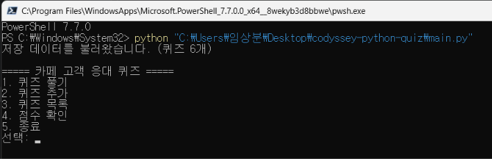
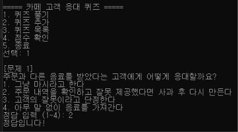
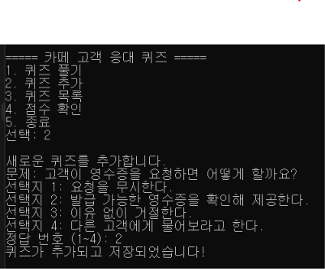
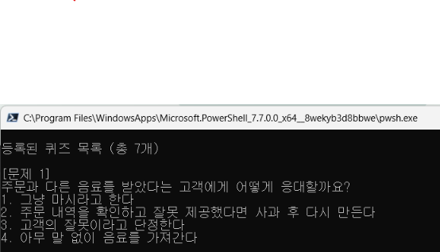
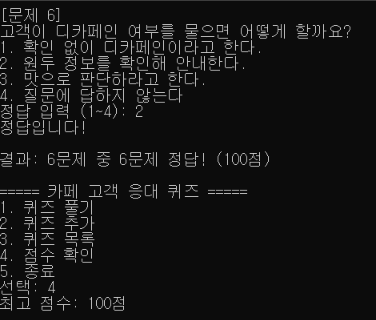
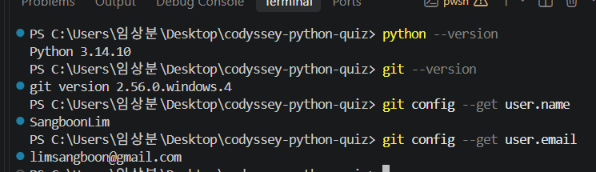
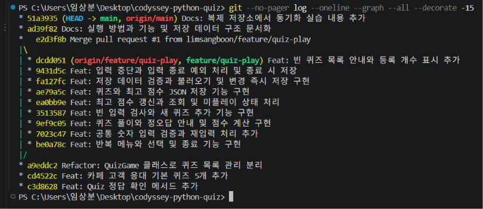
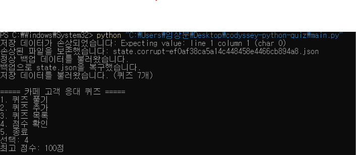

# 카페 고객 응대 퀴즈

## 프로젝트 개요
Python으로 만든 터미널 퀴즈 게임입니다.
객관식 퀴즈를 풀거나 새로운 문제를 추가할 수 있습니다.
퀴즈와 최고 점수는 파일에 저장되어 프로그램을 다시 실행해도 유지됩니다.

## 퀴즈 주제와 선정 이유
주제는 카페 고객 응대입니다.

1인 카페를 운영하면서 필요한 고객 응대 매뉴얼을 복습하기 위해
이 주제를 선택했습니다.

주문 확인, 대기 시간 안내, 잘못 제공된 음료 대응,
알레르기 정보 안내, 고객 불만 응대에 관한 기본 문제 5개를 포함합니다.

## 개발 환경
- Python 3.10 이상
- Python 표준 라이브러리만 사용: json, pathlib
- VS Code
- Git 및 GitHub

별도로 설치해야 하는 Python 라이브러리는 없습니다.

## 실행 방법
프로젝트 폴더에서 터미널을 열고 실행합니다.

```bash
python main.py
```

실행 후 메뉴 번호를 입력합니다.

```text
1. 퀴즈 풀기
2. 퀴즈 추가
3. 퀴즈 목록
4. 점수 확인
5. 종료
```

## 주요 기능
- 퀴즈 풀기: 선택지 번호를 입력하면 정오답과 최종 점수를 안내합니다.
- 퀴즈 추가: 문제, 선택지 4개, 정답 번호를 입력받아 저장합니다.
- 퀴즈 목록: 등록된 퀴즈 수와 문제·선택지를 보여 줍니다.
- 점수 확인: 최고 점수를 보여 주고, 아직 풀지 않은 경우도 안내합니다.
- 데이터 유지: 퀴즈 추가와 최고 점수 갱신 시 파일에 저장합니다.

점수는 정답 수를 전체 문제 수로 나눈 뒤 100을 곱하고 반올림합니다.
기존 최고 점수보다 높은 점수를 받으면 최고 점수를 갱신합니다.

## 입력 및 예외 처리
- 입력 앞뒤의 공백을 제거합니다.
- 숫자가 아닌 입력, 빈 입력, 허용 범위 밖 숫자는 다시 입력받습니다.
- 문제와 선택지는 빈 내용으로 등록할 수 없습니다.
- 퀴즈가 없으면 목록 보기와 퀴즈 풀이에서 안내합니다.
- 저장 파일이 없거나 손상되면 정상 백업에서 복구를 시도합니다.
- 사용 가능한 백업도 없으면 기본 퀴즈로 시작합니다.
- 파일 읽기·쓰기 오류를 안내합니다.
- Ctrl+C 또는 입력 스트림 종료 시 안내하고 저장을 시도한 뒤 종료합니다.

## 파일 구조
```text
codyssey-python-quiz/
├── .gitignore
├── README.md
├── main.py
└── state.json
```

- .gitignore: Python 임시 파일과 가상환경을 Git 관리에서 제외합니다.
- README.md: 프로젝트와 실행 방법을 설명합니다.
- main.py: 퀴즈 데이터, 클래스와 실행 코드를 포함합니다.
- state.json: 퀴즈 목록과 최고 점수를 저장합니다.

## 클래스 구조
### Quiz
문제 하나를 표현합니다.

- 속성: question, choices, answer
- display(): 문제와 선택지 출력
- check_answer(): 정답 여부 확인

### QuizGame
게임 전체를 관리합니다.

- 퀴즈 목록과 최고 점수 관리
- 메뉴 실행과 입력 검사
- 퀴즈 풀이, 추가, 목록 및 점수 조회
- 저장 데이터 검증과 파일 저장·불러오기

## 데이터 파일 설명
저장 파일은 프로젝트 루트의 state.json입니다.
main.py의 위치를 기준으로 경로를 지정하므로,
다른 폴더에서 프로그램을 실행해도 같은 파일을 사용합니다.

UTF-8 인코딩으로 저장하며, 구조는 다음과 같습니다.
아래는 문제 하나만 표시한 형식 예시입니다.

```json
{
    "quizzes": [
        {
            "question": "주문을 정확하게 접수하려면 어떻게 할까요?",
            "choices": [
                "고객의 말을 끝까지 듣지 않는다",
                "평소 인기 메뉴로 임의 변경한다",
                "온도와 크기는 확인하지 않는다",
                "메뉴, 수량, 온도와 추가 요청을 다시 확인한다"
            ],
            "answer": 4
        }
    ],
    "best_score": null
}
```

- quizzes: 저장된 퀴즈 목록
- question: 문제 내용
- choices: 선택지 4개
- answer: 1~4 중 정답 번호
- best_score: 0~100의 최고 점수. 아직 풀지 않았다면 null

파일을 불러올 때 필수 항목, 자료형, 선택지 수와 정답·점수 범위를 검사합니다.

## Git 작업 흐름
- 기능별로 변경 내용을 커밋하고 GitHub에 업로드했습니다.
- feature/quiz-play 브랜치에서 주요 기능을 개발했습니다.
- GitHub Pull Request를 통해 main 브랜치에 병합했습니다.
- 로컬 main에서 pull하여 병합 내용을 반영했습니다.

## 확인한 실행 결과
- 정답 5개: 100점
- 정답 4개: 80점
- 잘못된 숫자 입력과 빈 입력 처리
- 추가한 퀴즈와 최고 점수가 재실행 후 유지됨
- 저장 파일이 없거나 손상된 경우 기본 퀴즈로 실행됨
- 빈 퀴즈 목록 안내
- Ctrl+C 입력 시 안내 후 종료

## 저장소 복제 및 동기화 실습
별도 폴더에 git clone으로 저장소를 복제했습니다.
복제본에서 README를 수정하고 커밋·업로드한 뒤,
원래 작업 폴더에서 git pull로 변경 사항을 가져오는 실습입니다.

## 실행 화면

### 메뉴



### 퀴즈 풀기



### 퀴즈 추가



### 퀴즈 목록



### 최고 점수



## 개발 환경 및 Git 기록

### 개발 환경



### Git 커밋과 브랜치 병합 기록


## 저장소 및 개발 이력 증빙

- GitHub 저장소: https://github.com/limsangboon/codyssey-python-quiz
- 전체 커밋 기록: https://github.com/limsangboon/codyssey-python-quiz/commits/main/
- 기능 개발 및 병합 PR: https://github.com/limsangboon/codyssey-python-quiz/pull/1

기능별로 변경 내용을 기록했으며, main 브랜치에 10개 이상의 커밋이 있습니다.
feature/quiz-play 브랜치에서 주요 기능을 개발하고,
PR #1을 통해 main 브랜치에 병합했습니다.

### 개발 이력 확인 방법

커밋 개수는 다음 명령으로 확인할 수 있습니다.

```bash
git rev-list --count main
```

커밋과 브랜치 병합 기록은 다음 명령으로 확인할 수 있습니다.

```bash
git --no-pager log --oneline --graph --all --decorate -15
```

### Git 기록 화면

아래 화면은 커밋 목록과 브랜치 분기·병합 기록입니다.


## 커밋 작성 규칙

하나의 기능 구현, 오류 수정, 문서 정리처럼 목적이 구분되는 단위로 커밋합니다.
코드 변경은 관련 기능을 실행해 확인한 뒤 기록합니다.

커밋 메시지는 `유형: 변경 내용 요약` 형식으로 작성합니다.

- Feat: 새로운 기능 추가
- Fix: 잘못된 동작이나 오류 수정
- Docs: README와 실행 화면 등 문서 변경
- Refactor: 동작을 유지하면서 코드 구조 개선

이 프로젝트에서 사용한 예시는 다음과 같습니다.

- `Feat: 퀴즈 풀이와 정오답 안내 및 점수 계산 구현`
- `Docs: 실행 방법과 기능 및 저장 데이터 구조 문서화`
- `Refactor: QuizGame 클래스로 퀴즈 목록 관리 분리`

## 클래스 설계 이유

Quiz는 문제 하나의 데이터와 동작을 묶습니다.
question, choices, answer를 보관하고,
display()로 출력하며 check_answer()로 정답을 확인합니다.

QuizGame은 전체 퀴즈 목록과 최고 점수를 보관하고,
메뉴, 입력 검사, 게임 진행, 파일 저장·불러오기를 관리합니다.

이렇게 나누면 개별 문제의 처리와 게임 전체의 처리를 구분할 수 있습니다.
함수만 사용하는 방식도 가능하지만, 퀴즈 목록과 점수 같은 상태를
여러 함수에 전달해야 합니다.
클래스를 사용하면 상태와 관련 메서드를 한곳에 모을 수 있습니다.
다만 작은 프로그램에서는 클래스 구조가 코드 분량을 늘릴 수 있습니다.

## 기능별 수정 대상 메서드

모든 메서드는 main.py에 정의되어 있습니다.

| 변경할 내용 | 수정 대상 |
|---|---|
| 문제 출력과 정답 판정 | Quiz.display(), Quiz.check_answer() |
| 메뉴 구성과 기능 연결 | QuizGame.run() |
| 숫자와 빈 입력 검사 | QuizGame.read_number(), QuizGame.read_text() |
| 퀴즈 진행과 점수 계산 | QuizGame.play() |
| 새 퀴즈 등록 | QuizGame.add_quiz() |
| 퀴즈 목록 표시 | QuizGame.show_quizzes() |
| 최고 점수 조회 | QuizGame.show_score() |
| 저장 데이터 구조 검사 | QuizGame.validate_state() |
| 파일 불러오기와 오류 처리 | QuizGame.load_state() |
| 파일 저장 | QuizGame.save_state() |

## 데이터 저장 및 불러오기 흐름

1. 프로그램 시작 시 load_state()가 state.json을 읽습니다.
2. validate_state()가 데이터 구조와 값의 범위를 검사합니다.
3. 검사를 통과하면 퀴즈 목록과 최고 점수에 반영합니다.
4. add_quiz()에서 문제를 추가하면 save_state()를 호출합니다.
5. play()에서 최고 점수를 갱신하면 save_state()를 호출합니다.
6. Ctrl+C 또는 입력 스트림 종료 시에도 저장을 시도한 뒤 종료합니다.

저장 파일이 없거나 손상되면 안내 후 기본 퀴즈로 시작합니다.

### 오류 안내 예시

- 파일 없음: `저장 파일이 없어 기본 퀴즈로 시작합니다.`
- 읽기 또는 데이터 검사 실패: `저장 데이터를 불러오지 못했습니다: 오류 내용`
- 저장 실패: `데이터를 저장하지 못했습니다: 오류 내용`
- 입력 중단: `입력이 중단되어 게임을 종료합니다.`

저장 실패 시에는 파일 경로와 쓰기 권한, 저장 공간을 확인해야 합니다.
저장되지 않은 변경 사항은 프로그램 종료 후 유지되지 않을 수 있습니다.

## JSON 구조 선택 이유와 한계

quizzes는 여러 문제의 순서를 유지하기 위해 리스트로 저장합니다.
각 문제는 question, choices, answer를 이름으로 구분하기 위해
딕셔너리 형태로 구성합니다.
choices도 선택지 순서와 정답 번호의 대응을 유지하기 위해 리스트로 저장합니다.

JSON은 사람이 읽기 쉽고 다른 프로그램에서도 활용하기 좋습니다.
Python 표준 라이브러리만으로 처리할 수 있어 소규모 학습 프로젝트에 적합합니다.

다만 JSON은 객체의 메서드를 저장할 수 없으므로,
문제 데이터를 문자열, 리스트, 정수 등의 기본 자료형으로 바꿔 저장합니다.
불러온 뒤에는 해당 데이터로 Quiz 객체를 다시 만듭니다.

현재 방식은 파일 전체를 읽고 쓰므로 데이터가 커지면
처리 시간과 메모리 사용량이 증가합니다.
여러 프로그램이 동시에 파일을 수정하면 변경 내용이 덮어써질 수도 있습니다.
저장 도중 중단되면 파일이 손상될 가능성도 있습니다.

문제 수가 크게 늘거나 검색·부분 수정·동시 접근이 필요해지면,
SQLite 같은 데이터베이스 사용을 고려할 수 있습니다.

## 브랜치 검토 및 병합 기준

이 프로젝트에서는 feature/quiz-play에서 기능을 개발하고,
실행 결과를 확인한 뒤 PR #1을 통해 main에 병합했습니다.

추가 개발에서도 관련 기능의 정상 실행, 입력 오류 처리,
저장 데이터와 README의 일치 여부를 검토한 뒤 병합합니다.
충돌이 발생하면 충돌 내용을 수정하고 관련 기능을 다시 확인한 뒤 병합합니다.

## 저장 데이터 백업 및 복구

### 안전한 저장 방식
save_state()는 저장할 데이터를 검사한 뒤,
기존 state.json이 정상이면 state.backup.json에 백업합니다.

새 데이터는 같은 폴더의 임시 파일에 먼저 기록합니다.
기록을 완료한 뒤 os.replace()로 대상 파일을 교체합니다.
따라서 파일 내용을 직접 덮어쓰는 방식보다 저장 중 손상 위험을 줄입니다.

백업은 직전 저장 상태를 보관하므로,
복구 시 가장 최근 변경 일부는 포함되지 않을 수 있습니다.
동시 실행이나 모든 종류의 장치 장애까지 보호하는 방식은 아닙니다.

### 자동 복구 순서
1. 시작 시 state.json을 읽고 구조와 값을 검사합니다.
2. 손상된 파일은 state.corrupt-고유번호.json으로 보존합니다.
3. state.backup.json을 읽고 검사합니다.
4. 정상 백업이 있으면 state.json을 복구하고 게임을 실행합니다.
5. 사용 가능한 백업도 없으면 기본 퀴즈로 시작합니다.

파일 보존이나 복구에 실패하면 오류를 안내합니다.
정상 백업을 읽었지만 파일 복구에 실패한 경우에는
해당 실행에서 백업 데이터로 게임을 계속합니다.

### 관련 파일
- state.json: 현재 퀴즈와 최고 점수
- state.backup.json: 직전 정상 저장 데이터
- state.corrupt-고유번호.json: 확인을 위해 보존한 손상 파일
- *.tmp: 파일 교체 전에 사용하는 임시 파일

### 관련 메서드
- read_state_file(): 파일 읽기와 데이터 검사
- write_state_file(): 임시 파일 기록 후 대상 파일 교체
- preserve_corrupt_file(): 손상 파일 별도 보존
- restore_backup(): 백업 검사와 복구
- load_state(): 시작 시 불러오기 및 복구 흐름 관리
- save_state(): 정상 데이터 백업과 새 데이터 저장

### 직접 확인한 복구 결과
state.json을 잘못된 JSON으로 변경한 뒤 실행했습니다.
손상 파일이 별도로 보존되고, 백업에서 퀴즈 7개와
최고 점수 100점이 복구되는 것을 확인했습니다.

